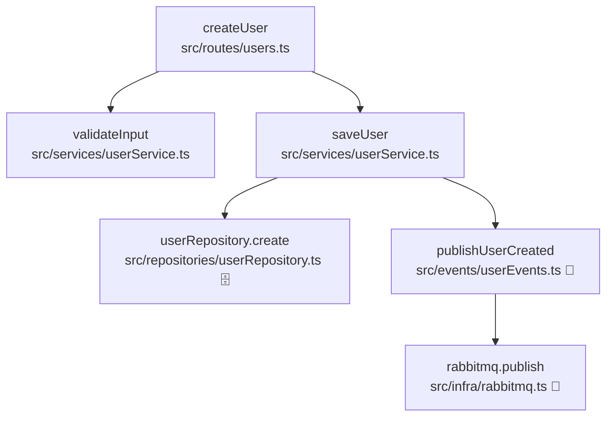

# Trace Callees (call stack downward)

> **Deprecated.** Use **[trace-code-flow](../trace-code-flow/SKILL.md)** with `direction: down` (or `@trace-code-flow down …`). This file is kept so you can restore the two-skill layout by copying `trace-callees/` and `trace-callers/` back and removing deprecation notices.

From an entry point (route handler, exported function, method), follow **callees** to explain what the code actually does — especially side effects.

**Sibling skill:** for the opposite direction (who calls this code), use [trace-callers](../trace-callers/SKILL.md).

## Entry point

The user provides one of:

- File path + function name (or line number)
- Route (e.g. `POST /api/users`)
- Symbol under cursor

If ambiguous, ask once. Then locate the function body before tracing.

## How to trace

1. Read the entry function. Note: purpose, side effects, key branches.
2. List **direct callees** — function calls and project-local imports only.
3. For each callee worth following, repeat step 1–2.
4. Prefer tracing paths that carry **behavior** (I/O, persistence, messaging, auth, external APIs). Skip pure helpers unless they gate side effects.
5. Use `Grep`, `SemanticSearch`, and `Read` — follow symbols into project source files.

### Do not follow

- `node_modules/` and third-party packages (express, lodash, etc.) — mention them by name only, e.g. "calls `prisma.user.create` (Prisma → DB)".
- Node built-ins (`fs`, `path`, `crypto`, …) unless the call is the side effect itself.
- Generated files (`dist/`, `.next/`, `build/`) unless the repo has no source.
- Test files unless the user asked about tests.

### Limits (fail-safe)

Stop expanding when **either** limit is hit:

| Limit | Value | On hit |
|-------|-------|--------|
| **Depth** | 15 levels from entry | Mark node `[depth limit]`; do not recurse further |
| **Breadth** | 10 callees at one level | List all names; fully trace only the most behavior-relevant; mark rest `[not traced — breadth limit]` |

Always report limits in **Truncation** (see output format). Never silently omit.

## Side effects to flag

Call out explicitly when seen (project code or known library boundary):

- Database read/write (ORM, raw SQL, Redis)
- Message queue (RabbitMQ, Kafka, Bull, SQS, …)
- HTTP/API calls (fetch, axios, gRPC clients)
- File system read/write
- Cache (Redis, in-memory store with TTL)
- Email / SMS / push notifications
- Auth / permission checks that gate the above

## Output format

```markdown
## Summary
[2–4 sentences: what this entry point does end-to-end, main side effects]

## Side effects
- [DB] …
- [Queue] …
- [HTTP] …
(or "None in traced paths")

## Call graph

\`\`\`mermaid
flowchart TD
  …
\`\`\`

## Functions

| Function | File | Explanation |
|----------|------|-------------|
| `handlerName` | `src/routes/users.ts` | One-line purpose |
| … | … | … |

## Truncation
[None | depth limit at X | breadth limit at Y — list skipped symbols]
```

### Mermaid rules

- Node label: `` `functionName` `` + `<br/>` + `` `relative/path.ts` ``
- Root = entry point. Arrows = calls (parent → callee).
- Use `flowchart TD` (top-down).
- Side-effect nodes: append ` 🗄️` (DB), ` 📨` (queue), ` 🌐` (HTTP) in the label when helpful.
- Keep the graph readable; if >20 nodes, show the main path fully and collapse minor helpers into a single `[helpers]` node with a note in Truncation.

## Example (3 levels, one branch)

**Entry:** `POST /users` → `createUser` in `src/routes/users.ts`

**Summary:** Creates a user after validation, persists to Postgres, publishes a creation event.

**Side effects:** DB write, RabbitMQ publish.



| Function | File | Explanation |
|----------|------|-------------|
| `createUser` | `src/routes/users.ts` | Route handler; orchestrates validation, save, and event publish |
| `validateInput` | `src/services/userService.ts` | Checks email format and uniqueness; throws on invalid |
| `saveUser` | `src/services/userService.ts` | Maps DTO to entity, persists, then notifies |
| `userRepository.create` | `src/repositories/userRepository.ts` | Inserts row via Prisma |
| `publishUserCreated` | `src/events/userEvents.ts` | Builds envelope and sends to queue |
| `rabbitmq.publish` | `src/infra/rabbitmq.ts` | Publishes to `user.created` exchange |

**Truncation:** None.

## Rules

- Lead with summary and side effects, not search steps.
- Every function in the graph gets a one-line row in **Functions**.
- Cite project code with `startLine:endLine:filepath` when pointing at non-obvious logic.
- Do not dump full source; synthesize behavior.
- If the entry point is thin (delegates in one line), say so and spend depth on the delegate.
