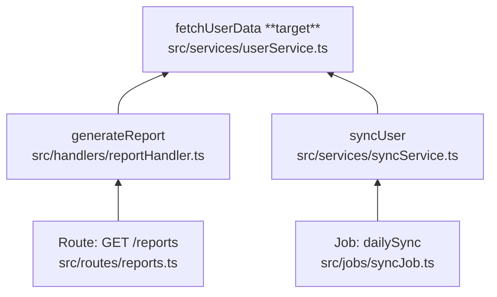

# Trace Callers (call stack upward)

> **Deprecated.** Use **[trace-code-flow](../trace-code-flow/SKILL.md)** with `direction: up` (or `@trace-code-flow up …`). This file is kept so you can restore the two-skill layout by copying `trace-callees/` and `trace-callers/` back and removing deprecation notices.

From a target (function, method, module export), follow **callers** upward to find how execution reaches this code — HTTP routes, cron jobs, queue consumers, CLI commands, etc.

**Sibling skill:** for the opposite direction (what this code calls), use [trace-callees](../trace-callees/SKILL.md).

## Target

The user provides one of:

- File path + function name (or line number)
- Symbol under cursor
- "Who calls X?"

If ambiguous, ask once. Then locate the definition before tracing.

## How to trace

1. Identify the **target symbol** (function, method, or exported binding).
2. Search for references in project source:
   - `Grep` for the symbol name (filter by file type; exclude `node_modules`).
   - Prefer definition-aware search: import paths, `router.get`, `app.use`, job registration, etc.
3. For each caller, determine **context** (route, middleware, worker, test, internal helper).
4. Recurse upward until you hit **entry points** or a limit.
5. Merge duplicate paths; list **distinct origins** separately.

### Entry points (stop upward here)

- HTTP route handlers / middleware registered on a router
- Queue consumer / message handler
- Cron / scheduled task
- CLI command or script entry
- WebSocket / SSE handler
- Test `it(` / `describe(` (label as test origin)
- `index.ts` / bootstrap that wires the app

### Do not follow

- `node_modules/` — note library usage only (e.g. "registered by Express router in project code").
- Generated/build output unless no source exists.
- Following **into** callees (that is trace-callees).

### Limits (fail-safe)

Stop expanding when **either** limit is hit:

| Limit | Value | On hit |
|-------|-------|--------|
| **Depth** | 15 levels upward from target | Mark node `[depth limit]` |
| **Breadth** | 10 callers at one level | List all; fully trace the most relevant; mark rest `[not traced — breadth limit]` |

Always report limits in **Truncation**. Never silently omit.

When the target has many callers (shared util), prioritize: production entry points first, then internal callers; mention total caller count.

## Output format

```markdown
## Summary
[2–4 sentences: what reaches this code, main entry points]

## Origins
- [Route] `GET /reports` via …
- [Job] `dailySync` cron via …
(or list each distinct entry point)

## Caller graph

\`\`\`mermaid
flowchart BT
  …
\`\`\`

## Functions

| Function | File | Explanation |
|----------|------|-------------|
| `fetchUserData` | `src/services/userService.ts` | **Target** — loads user from DB |
| … | … | … |

## Truncation
[None | depth limit at X | breadth limit at Y — list skipped symbols]
```

### Mermaid rules

- Use `flowchart BT` (bottom-up): **target at bottom**, origins at top.
- Node label: `` `functionName` `` + `<br/>` + `` `relative/path.ts` ``
- Arrows: caller → callee (point toward the target).
- Mark the target node with ` **target**` in the label.
- Entry-point nodes: prefix type, e.g. `Route: GET /reports<br/>…`.

## Example (3 levels, two origins)

**Target:** `fetchUserData` in `src/services/userService.ts`

**Summary:** Shared service used by the reports API and the nightly sync job.

**Origins:**

- `GET /reports` → `generateReport` → `fetchUserData`
- Cron `dailySync` → `syncUser` → `fetchUserData`



| Function | File | Explanation |
|----------|------|-------------|
| `fetchUserData` | `src/services/userService.ts` | **Target** — reads user record from repository |
| `generateReport` | `src/handlers/reportHandler.ts` | Builds report payload for HTTP response |
| `GET /reports` | `src/routes/reports.ts` | Express route; entry point for report downloads |
| `syncUser` | `src/services/syncService.ts` | Reconciles user with external system |
| `dailySync` | `src/jobs/syncJob.ts` | Cron entry; runs sync for all active users |

**Truncation:** None.

## Rules

- Lead with origins, not search steps.
- Distinguish **one shared target, many origins** vs **single call chain**.
- Every node in the graph gets a one-line row in **Functions**; mark the target clearly.
- Cite project code with `startLine:endLine:filepath` for non-obvious registration (route mount, job schedule).
- Do not dump full source; synthesize call relationships.
- If no callers found in project code, say so and suggest dynamic/indirect use (reflection, stringly dispatch, plugin load).
