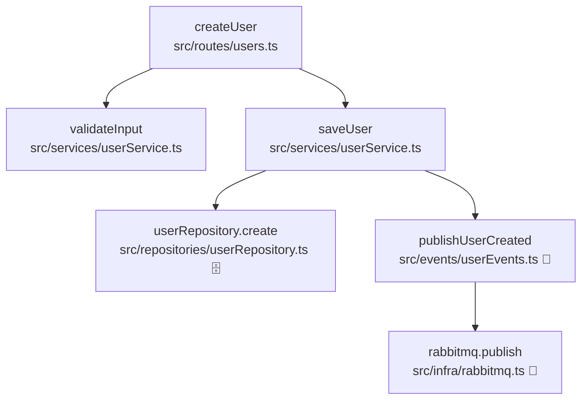
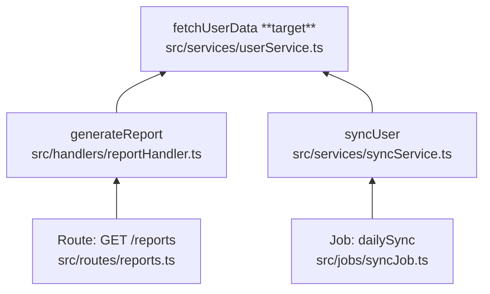

# Trace Code Flow

Trace call relationships from a starting point in project source. Two directions:

| Direction | Alias   | Question answered                       |
| --------- | ------- | --------------------------------------- |
| **down**  | callees | What does this code call? Side effects? |
| **up**    | callers | Who reaches this code? Entry points?    |

## Invocation (parameters)

Skills have no typed parameter API — pass options in the same message as `@trace-code-flow`:

```
@trace-code-flow direction: down POST /api/users
@trace-code-flow direction: up fetchUserData in src/services/userService.ts
@trace-code-flow down   # shorthand
@trace-code-flow up from line 42 in src/handlers/report.ts
```

**Resolve direction** (first match wins):

1. Explicit: `direction: down|up`, or standalone `down` / `up` / `callees` / `callers`
2. Intent: "what does it do", "side effects" → **down**; "who calls", "origins", "entry points" → **up**
3. If still unclear, ask once: "Trace **down** (callees) or **up** (callers)?"

**Starting point** (required): file + function/line, route, or symbol under cursor.

## Shared rules

### Do not follow

- `node_modules/` and third-party packages — name only at the boundary (e.g. "Prisma → DB").
- Node built-ins unless they are the side effect.
- Generated output (`dist/`, `.next/`, `build/`) unless no source exists.
- Tests unless the user asked (up: label as test origin).

### Limits (fail-safe)

Stop when **either** limit is hit:

| Limit       | Value                    | On hit                                                                      |
| ----------- | ------------------------ | --------------------------------------------------------------------------- |
| **Depth**   | 15 levels from start     | Mark node `[depth limit]`                                                   |
| **Breadth** | 10 branches at one level | List all; trace the most relevant; mark rest `[not traced — breadth limit]` |

Always report in **Truncation**. Never silently omit.

### Mermaid node labels

`` `functionName` `` + `<br/>` + `` `relative/path.ts` ``

---

## Direction: down (callees)

Follow **callees** from an entry point. Emphasize side effects.

### Workflow

1. Read the entry function: purpose, side effects, branches.
2. List direct callees (project-local calls and imports).
3. Recurse into paths that carry behavior (I/O, persistence, messaging, auth, external APIs).
4. Use `Grep`, `SemanticSearch`, `Read`.

### Side effects to flag

DB, queue (RabbitMQ/Kafka/Bull/…), HTTP/gRPC, filesystem, cache, email/SMS, auth gates.

### Output (down)

```markdown
## Direction

Down (callees)

## Summary

[2–4 sentences: end-to-end behavior, main side effects]

## Side effects

- [DB] …
  (or "None in traced paths")

## Call graph

\`\`\`mermaid
flowchart TD
…
\`\`\`

## Functions

| Function | File | Explanation |
| -------- | ---- | ----------- |

## Truncation

[None | …]
```

- Graph: `flowchart TD`, root = entry, arrows parent → callee.
- Optional icons: 🗄️ DB, 📨 queue, 🌐 HTTP.
- If >20 nodes, collapse minor helpers; note in Truncation.

### Example (down): 3 levels, one branch

**Start:** `POST /users` → `createUser` (`src/routes/users.ts`)



| Function                | File                                 | Explanation                          |
| ----------------------- | ------------------------------------ | ------------------------------------ |
| `createUser`            | `src/routes/users.ts`                | Orchestrates validate, save, publish |
| `validateInput`         | `src/services/userService.ts`        | Validates email; throws if invalid   |
| `saveUser`              | `src/services/userService.ts`        | Persists entity, then notifies       |
| `userRepository.create` | `src/repositories/userRepository.ts` | Inserts via Prisma                   |
| `publishUserCreated`    | `src/events/userEvents.ts`           | Builds event envelope                |
| `rabbitmq.publish`      | `src/infra/rabbitmq.ts`              | Publishes to `user.created`          |

---

## Direction: up (callers)

Follow **callers** to entry points: routes, jobs, CLI, queue consumers.

### Workflow

1. Identify target symbol.
2. `Grep` references (exclude `node_modules`); follow imports, router mounts, job registration.
3. Recurse upward to entry points; merge duplicate paths.
4. Many callers → prioritize production entry points; report total count.

### Entry points (stop here)

HTTP routes/middleware, queue consumers, cron, CLI, WebSocket/SSE, tests, app bootstrap.

### Output (up)

```markdown
## Direction

Up (callers)

## Summary

[2–4 sentences: how execution reaches this code]

## Origins

- [Route] …
- [Job] …

## Caller graph

\`\`\`mermaid
flowchart BT
…
\`\`\`

## Functions

| Function | File | Explanation |
| -------- | ---- | ----------- |

## Truncation

[None | …]
```

- Graph: `flowchart BT`, target at bottom, origins at top.
- Mark target with ` **target**`; prefix entry nodes (`Route:`, `Job:`).
- Arrows caller → callee (toward target).

### Example (up): 3 levels, two origins

**Start:** `fetchUserData` (`src/services/userService.ts`)



| Function         | File                            | Explanation                             |
| ---------------- | ------------------------------- | --------------------------------------- |
| `fetchUserData`  | `src/services/userService.ts`   | **Target** — loads user from repository |
| `generateReport` | `src/handlers/reportHandler.ts` | Builds report for HTTP response         |
| `GET /reports`   | `src/routes/reports.ts`         | Express route entry point               |
| `syncUser`       | `src/services/syncService.ts`   | Reconciles with external system         |
| `dailySync`      | `src/jobs/syncJob.ts`           | Cron entry for nightly sync             |

---

## Rules

- State **Direction** at the top of the report.
- Lead with summary, not search steps.
- Every graph node → one line in **Functions**.
- Cite non-obvious logic with `startLine:endLine:filepath`.
- Synthesize behavior; do not dump source.
- **Down only:** do not follow into callers. **Up only:** do not follow into callees.

## Split skills (legacy)

Deprecated standalone skills remain in this repo for revert: [trace-callees](../trace-callees/SKILL.md), [trace-callers](../trace-callers/SKILL.md).
